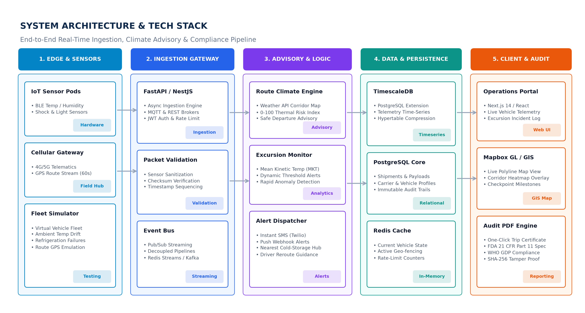
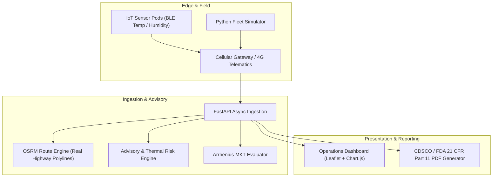

# ❄️ ColdChain Integrity Advisor

An intelligent predictive route climate engineering and real-time in-transit cold-chain compliance platform for vaccines, biopharmaceuticals, and high-value perishables across India. Built in compliance with **CDSCO (Govt. of India)**, **US FDA 21 CFR Part 11**, and **WHO Good Distribution Practices (GDP) Annex 5**.



---

## 🌟 Key Features

1. **Pre-Transit Route Risk & Climate Advisory:**
   - Evaluates highway corridors across India (NH 48, NH 44, NH 19, Western Corridor).
   - Dynamically models ambient heatwaves ($35^\circ\text{C}$ to $43^\circ\text{C}$) against payload insulation decay curves.
   - Computes a composite **0–100 Route Risk Score** and recommends optimal night departure windows and intermediate re-icing hubs (e.g., Udaipur, Kurnool, Surat, Nagpur).

2. **Dynamic Road Network Routing (OSRM Integration):**
   - Automatically computes real highway driving paths and distances between Indian logistics hubs (Pune, Delhi, Hyderabad, Bengaluru, Ahmedabad, Mumbai, Chennai, Kolkata, etc.).
   - Dynamically renders interactive road polylines on the operations map.

3. **Live IoT Telemetry & Map Operations Tower:**
   - Real-time simulated streaming of vehicle GPS coordinates, cargo temperature, ambient weather, humidity, and door-opening sensors.
   - Dynamic route polyline color coding (**Green = Safe**, **Red = Excursion**).
   - Real-time time-series telemetry charts powered by Chart.js.

4. **Excursion Alerting & Mean Kinetic Temperature (MKT):**
   - Automatic calculation of Mean Kinetic Temperature using the standard **USP <1151> Arrhenius equation** ($\Delta H/R = 10,000 \text{ K}$).
   - Instant critical alert dispatch if cargo drifts near or exceeds regulatory temperature bands.

5. **Automated Regulatory Compliance Audit Certificates (PDF):**
   - 1-click generation of tamper-evident PDF inspection certificates using ReportLab.
   - Features SHA-256 cryptographic audit digests, temperature limits, recorded metrics, excursion logs, and digital signature sign-offs.

6. **Interactive Demo Controls:**
   - Single-click simulation of refrigeration failure ("⚡ Simulate Refrigerator Breakdown") to demo live excursion alerts, emergency re-routing advice, and compliance impact.

---

## 🏗️ System Architecture



---

## 🚀 Quick Start Guide

### Prerequisites
- Python 3.10+
- Git

### Installation

1. **Clone the repository:**
   ```bash
   git clone https://github.com/patil2303/ColdChain-Integrity-Advisor.git
   cd ColdChain-Integrity-Advisor
   ```

2. **Install dependencies:**
   ```bash
   pip install -r requirements.txt
   ```

3. **Run the Application:**
   - **On Windows:** Double click `run_mvp.bat` or run:
     ```bash
     cd server
     python -m uvicorn main:app --host 127.0.0.1 --port 8000 --reload
     ```

4. **Access the Operations Dashboard:**
   Open your browser to:
   👉 **`http://127.0.0.1:8000`**

---

## 📁 Repository Structure

```
ColdChain-Integrity-Advisor/
│
├── server/
│   ├── main.py               # FastAPI application & REST endpoints
│   ├── models.py             # Pydantic schemas (Shipment, TelemetryPoint, RouteAdvisory)
│   ├── simulator.py          # Background IoT simulator & live vehicle advancement
│   ├── advisory_engine.py    # Highway route calculation (OSRM) & Arrhenius MKT formula
│   ├── compliance_pdf.py     # CDSCO / FDA 21 CFR Part 11 PDF audit generator
│   └── static/
│       └── index.html        # Single-page operations tower UI (Tailwind, Leaflet, Chart.js)
│
├── PRD_Cold_Chain_Integrity_Advisory.pdf   # Complete 3-Page Product Requirements Document
├── diag_system_arch.png                    # System architecture & tech stack diagram
├── diag_workflow.png                       # Operational lifecycle workflow diagram
├── diag_thermal_graph.png                  # Thermal excursion trajectory curve
├── requirements.txt                        # Python dependencies
├── run_mvp.bat                             # One-click Windows launch script
└── README.md                               # Project documentation
```

---

## 📜 Regulatory Standards Aligned
- **CDSCO (Central Drugs Standard Control Organisation, Govt. of India)** Good Distribution Practices
- **WHO Technical Report Series (TRS 961)**, Annex 5 (Good Distribution Practices for Pharmaceutical Products)
- **US FDA 21 CFR Part 11** (Electronic Records and Digital Signatures)
- **USP <1151> / <1079>** Mean Kinetic Temperature (MKT) Calculations
